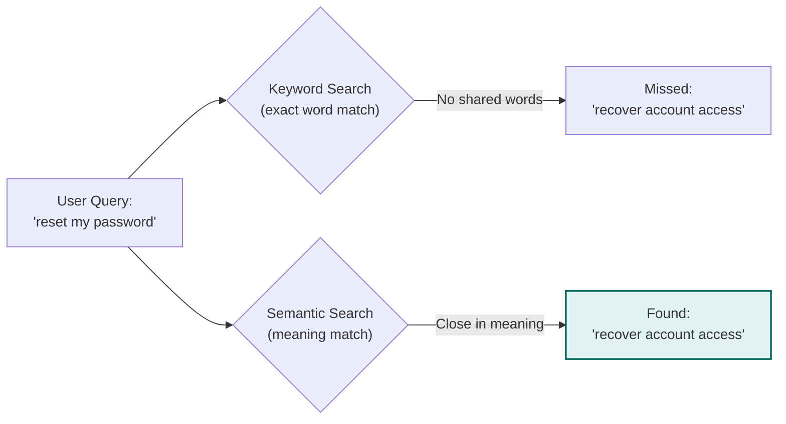
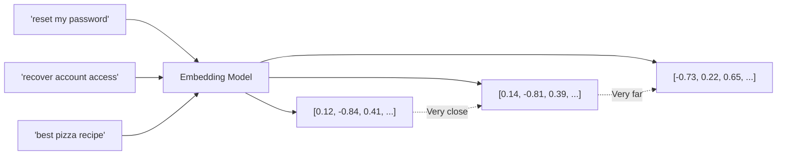
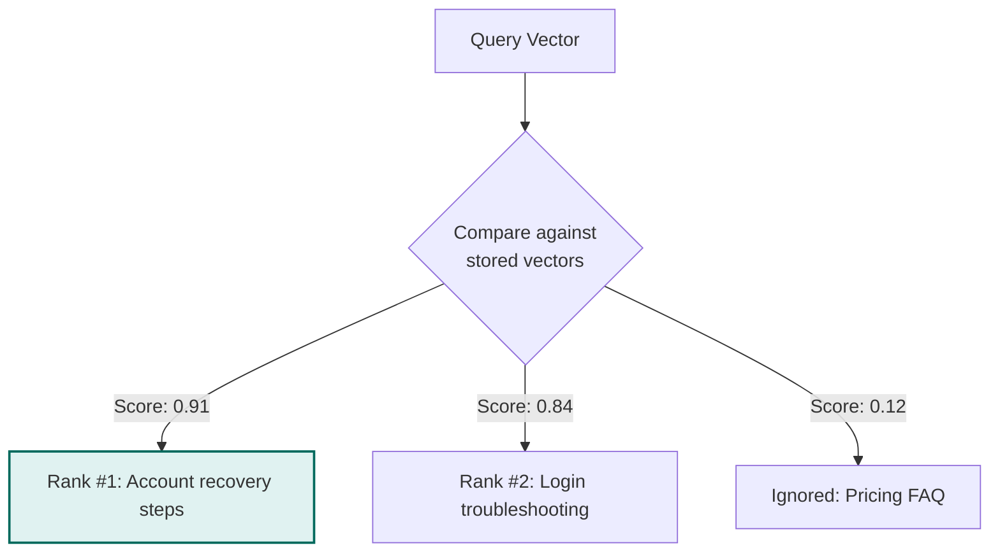
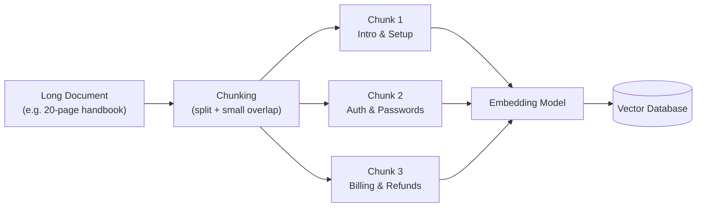
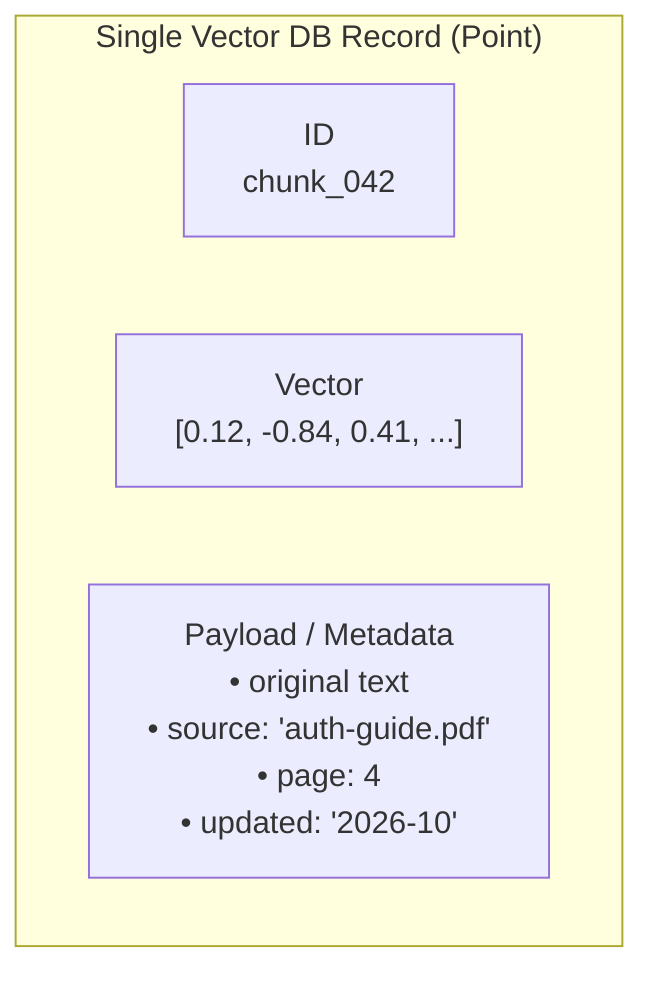
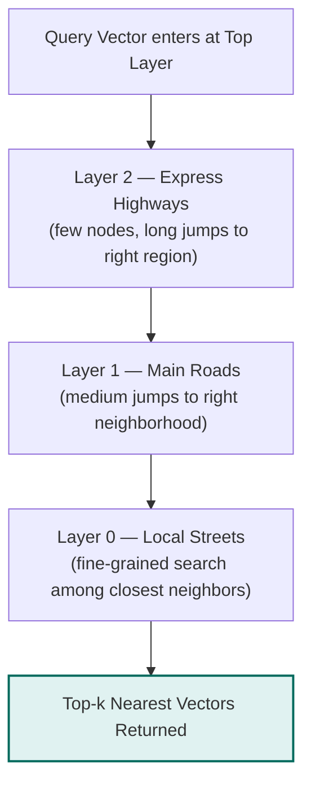
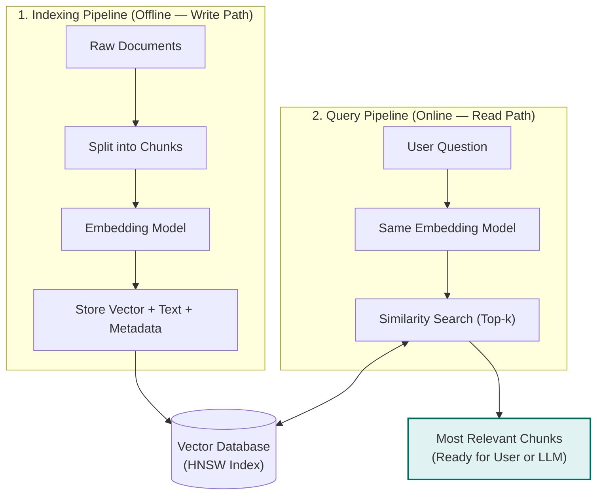
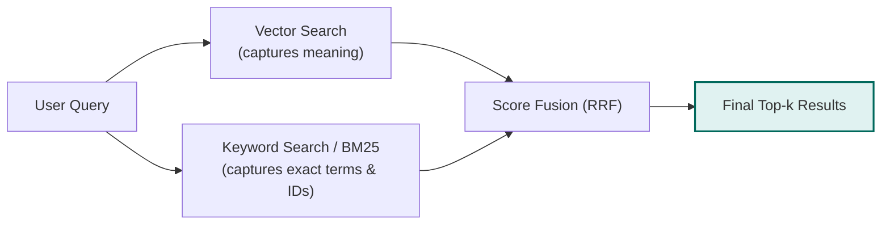

> **Before you build any RAG system or AI agent, you need one core building block: a way for computers to search by *meaning*, not just exact words. That is what embeddings and vector databases do.**

---

## 1. Why Normal Search Breaks

If you have ever used `Ctrl+F` or a basic SQL `LIKE` query, you already know how traditional **keyword search** works: it checks whether the exact characters you typed appear inside a document.

That works great when you search for an exact error code (`ERR_404`) or a person's name. It breaks the moment two people use different words to describe the exact same idea:

| User Searches For | Document Actually Says | Keyword Search Result |
|-------------------|------------------------|-----------------------|
| *"How do I reset my password?"* | *"Steps to recover account access"* | **Miss** (zero shared words) |
| *"Cheap flights to Paris"* | *"Budget airfare to France's capital"* | **Miss** |
| *"Python memory leak"* | *"Fixing high RAM usage in Python"* | **Partial / weak match** |

To fix this, computers need a way to represent the **meaning** of text in a format they can compare mathematically. That format is an **embedding**.

---

## 2. What Is an Embedding?

An **embedding** is simply a list of numbers (a **vector**) that captures the meaning of a piece of text — a word, a sentence, or a paragraph.

Think of it like **GPS coordinates on a map**, except instead of mapping physical places, it maps *ideas*:

- Places that are physically near each other have similar latitude and longitude.
- Texts that have similar **meaning** get placed near each other in this mathematical space.

### A Simple 2D Intuition

Imagine describing animals using just two numbers: **(Size, Friendliness)** on a scale from `0` to `1`:

| Word | Size | Friendliness | Coordinates |
|------|------|--------------|-------------|
| **Puppy** | 0.2 | 0.95 | `[0.20, 0.95]` |
| **Kitten** | 0.15 | 0.90 | `[0.15, 0.90]` |
| **Shark** | 0.85 | 0.05 | `[0.85, 0.05]` |
| **Laptop** | 0.25 | 0.00 | `[0.25, 0.00]` |

Even with just two numbers, notice what happens automatically: **Puppy** and **Kitten** land right next to each other, far away from **Shark** and **Laptop**.

Real **embedding models** (neural networks trained on billions of text pairs) do the exact same thing — except instead of 2 numbers, they produce **hundreds or thousands of numbers** (commonly **384, 768, 1024, or 1536 dimensions**). Each number quietly captures a subtle aspect of topic, intent, tone, language, or context.

> **Key mental model:** You don't define the dimensions yourself. The embedding model learns how to place texts with similar meanings into the same neighborhood of vector space.

---

## 3. How Computers Measure "Similar Meaning"

Once two pieces of text are turned into vectors, finding out whether they mean the same thing becomes a simple geometry question: **how close are these two vectors?**

There are three common ways to measure distance or similarity:

| Metric | What It Measures | Plain-English Intuition | Best Used When |
|--------|------------------|-------------------------|----------------|
| **Cosine Similarity** | The **angle** between two vectors (score from `-1` to `1`) | Checks if two arrows point in the same direction, ignoring length | Text & document search (most common default) |
| **Dot Product** | Angle **and** length combined | Same as Cosine when vectors are normalized, and faster to compute | Large-scale search with normalized embeddings |
| **Euclidean Distance (L2)** | Straight-line distance between two points | Measuring distance with a ruler between two pins on a map | Image embeddings or clustering tasks |

For most text applications, **Cosine Similarity** is the easiest one to picture:
- **`1.0`** → pointing in the exact same direction (identical meaning).
- **`0.0`** → perpendicular (unrelated topics).
- **`-1.0`** → pointing in opposite directions.

---

## 4. Why Chunking Comes First

A common beginner mistake is trying to embed an entire 50-page PDF as **one single vector**.

Why doesn't that work well?
1. **Embedding models have a token limit** — anything past the limit gets silently cut off.
2. **Meaning gets diluted** — averaging 50 pages about pricing, security, APIs, and refunds into one point produces a vague "blob" that matches none of those topics sharply.
3. **You waste LLM context later** — if a search matches a 50-page document, you don't want to feed all 50 pages into an LLM prompt just to answer one question.

Instead, documents are split into smaller pieces called **chunks** (often a few paragraphs or ~300–800 tokens each) with a small **overlap** between neighboring chunks so sentences at the boundary don't lose their context.

---

## 5. What Is a Vector Database?

If you only have 50 chunks, you could store their vectors in a plain file and compare your query against every single one. That takes a fraction of a millisecond.

Now imagine you have **5 million chunks**, each with **1,536 numbers**. Comparing your query against all 5 million vectors one by one (brute-force search) becomes slow and expensive.

A **Vector Database** (such as Qdrant, Pinecone, Milvus, Weaviate, Chroma, or PostgreSQL with `pgvector`) is a database purpose-built to store, index, and search high-dimensional vectors at high speed.

### What Lives Inside One Record?

A vector database does **not** just store raw numbers. Every stored item usually holds three things together:

### Traditional SQL Database vs. Vector Database

| Feature | Traditional SQL Database | Vector Database |
|---------|--------------------------|-----------------|
| **Data model** | Structured rows & columns | Vectors + payload (text & metadata) |
| **Query type** | Exact matches (`WHERE id = 42`, `LIKE '%reset%'`) | Similarity search ("find the top-k closest meanings") |
| **Primary index** | B-Tree / Hash indexes | Vector indexes (HNSW, IVF, PQ) |
| **Result** | Exact set of matching rows | Ranked list ordered by similarity score |
| **Best for** | Users, orders, transactions, analytics | Semantic search, RAG, recommendations, deduplication |

> **Note:** You don't always need a brand-new database. If your app already uses PostgreSQL and your dataset is moderate, extensions like `pgvector` let you keep relational data and vectors side by side. Dedicated vector databases shine when you need high throughput, advanced filtering, or hybrid search at scale.

---

## 6. How Vector Search Stays Fast (ANN & HNSW)

How does a vector database search millions of vectors in a few milliseconds without checking every single one?

It trades a tiny amount of perfection for massive speed using **ANN — Approximate Nearest Neighbors**. Instead of checking 100% of vectors, it builds a smart index that navigates straight to the right neighborhood and returns the closest matches ~98–99% accurately in milliseconds.

The most popular vector index today is **HNSW (Hierarchical Navigable Small World)** — and it works just like traveling across a country:

1. **Top layer (Highways / Flights):** Very few nodes with long-distance connections. You quickly jump to the right region of vector space.
2. **Middle layer (Regional Roads):** More nodes, medium hops. You narrow down to the right city.
3. **Bottom layer (Local Streets):** Every vector is here with short links to its neighbors. You walk a few steps to find the exact top-*k* closest matches.

---

## 7. The Two Pipelines: Indexing vs. Querying

Every vector search system has two separate workflows: an **offline indexing pipeline** (run when documents are added or updated) and an **online query pipeline** (run every time a user asks a question).

Notice the most important rule in the entire diagram: **both pipelines must use the exact same embedding model.**

---

## 8. Metadata Filtering & Hybrid Search

Pure vector search is powerful, but real applications almost always combine it with two upgrades:

### 8.1 Metadata Filtering
Suppose a user asks *"What changed in our 2026 refund policy?"*. Semantic search might return chunks from 2023, 2024, and 2026 because all of them talk about refunds.

By storing metadata (`year: 2026`, `department: "billing"`, `tenant_id: "acme"`) alongside each vector, the database can **filter first (or during search)** so it only returns similar chunks that also satisfy your exact rules — essential for multi-user permissions and up-to-date answers.

### 8.2 Hybrid Search (Vectors + Keywords)
Embeddings are great at concepts (*"recover account access"*), while traditional keyword search (like **BM25**) is great at exact strings (*"SKU-99281"*, *"HTTP 502"*, *"LangGraph"*).

**Hybrid search** runs both at the same time and merges the two ranked lists (commonly using **Reciprocal Rank Fusion**), giving you the best of both worlds:

---

## 9. Common Beginner Pitfalls

1. **Mixing embedding models:** Indexing documents with Model A and querying with Model B produces nonsense — every model builds its own private coordinate system. If you switch embedding models, you must re-embed your documents.
2. **Chunks that are too small or too big:** Single sentences lose surrounding context; huge multi-page chunks dilute meaning. Start around a few hundred tokens with ~10–15% overlap, then test on real questions.
3. **Forgetting metadata filters:** Never rely on vector similarity alone for access control or time-sensitive filters — enforce them explicitly with metadata.
4. **Assuming "high similarity" means "correct answer":** A vector database *always* returns the top-*k* closest chunks, even if your knowledge base has nothing relevant to the question. The closest match in an empty neighborhood can still be completely irrelevant.

---

## 10. How This Connects to RAG 

Everything in this note forms the **retrieval foundation** behind modern AI applications:

- **Semantic Search** stops at returning the top-*k* chunks to a user.
- **Classic RAG** takes those top-*k* chunks and hands them to an LLM to write a grounded answer.
- **Agentic RAG** wraps this entire retrieval step inside an autonomous loop that grades whether the retrieved chunks are actually useful, rewrites the query when they aren't, and chooses between multiple tools.**.
